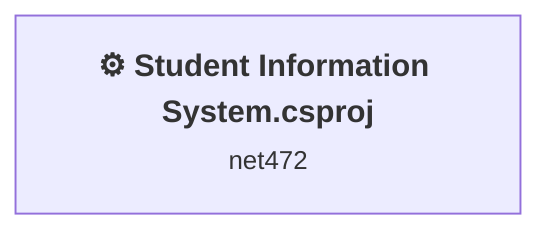
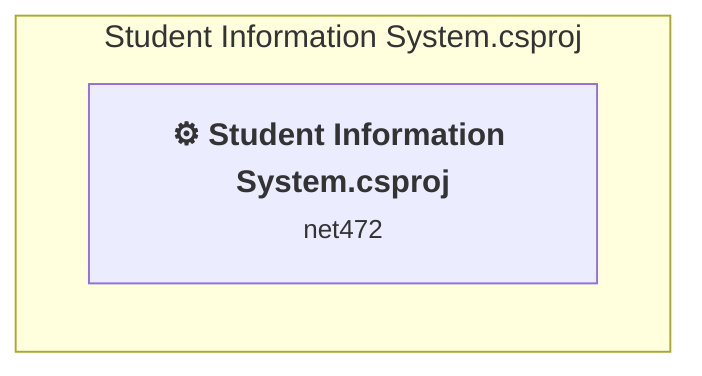

# Projects and dependencies analysis

This document provides a comprehensive overview of the projects and their dependencies in the context of upgrading to .NETCoreApp,Version=v10.0.

## Table of Contents

- [Executive Summary](#executive-Summary)
  - [Highlevel Metrics](#highlevel-metrics)
  - [Projects Compatibility](#projects-compatibility)
  - [Package Compatibility](#package-compatibility)
  - [API Compatibility](#api-compatibility)
  - [Binding Redirect Configuration](#binding-redirect-configuration)
- [Aggregate NuGet packages details](#aggregate-nuget-packages-details)
- [Top API Migration Challenges](#top-api-migration-challenges)
  - [Technologies and Features](#technologies-and-features)
  - [Most Frequent API Issues](#most-frequent-api-issues)
- [Projects Relationship Graph](#projects-relationship-graph)
- [Project Details](#project-details)

  - [Student Information System.csproj](#student-information-systemcsproj)

## Executive Summary

### Highlevel Metrics

| Metric | Count | Status |
| :--- | :---: | :--- |
| Total Projects | 1 | All require upgrade |
| Total NuGet Packages | 30 | 7 need upgrade |
| Total Code Files | 7 |  |
| Total Code Files with Incidents | 2 |  |
| Total Lines of Code | 1173 |  |
| Total Number of Issues | 21 |  |
| Estimated LOC to modify | 0+ | at least 0.0% of codebase |

### Projects Compatibility

| Project | Target Framework | Difficulty | Package Issues | API Issues | Binding Issues | Est. LOC Impact | Description |
| :--- | :---: | :---: | :---: | :---: | :---: | :---: | :--- |
| [Student Information System.csproj](#student-information-systemcsproj) | net472 | 🟢 Low | 13 | 0 | 6 |  | ClassicWinForms, Sdk Style = False |

### Package Compatibility

| Status | Count | Percentage |
| :--- | :---: | :---: |
| ✅ Compatible | 23 | 76.7% |
| ⚠️ Incompatible | 4 | 13.3% |
| 🔄 Upgrade Recommended | 3 | 10.0% |
| ***Total NuGet Packages*** | ***30*** | ***100%*** |

### API Compatibility

| Category | Count | Impact |
| :--- | :---: | :--- |
| 🔴 Binary Incompatible | 0 | High - Require code changes |
| 🟡 Source Incompatible | 0 | Medium - Needs re-compilation and potential conflicting API error fixing |
| 🔵 Behavioral change | 0 | Low - Behavioral changes that may require testing at runtime |
| ✅ Compatible | 0 |  |
| ***Total APIs Analyzed*** | ***0*** |  |

### Binding Redirect Configuration

| Severity | Count | Description |
| :--- | :---: | :--- |
| 🔴Mandatory | 3 | Must be fixed to avoid runtime failures |
| 🟡Potential | 3 | May cause issues in certain scenarios |
| ***Total Binding Issues*** | ***6*** | ***Across 1 project(s)*** |

## Aggregate NuGet packages details

| Package | Current Version | Suggested Version | Projects | Description |
| :--- | :---: | :---: | :--- | :--- |
| BouncyCastle.Cryptography | 2.6.2 |  | [Student Information System.csproj](#student-information-systemcsproj) | ✅Compatible |
| Google.Protobuf | 3.35.0 |  | [Student Information System.csproj](#student-information-systemcsproj) | ✅Compatible |
| HarfBuzzSharp | 8.3.1.1 |  | [Student Information System.csproj](#student-information-systemcsproj) | ✅Compatible |
| HarfBuzzSharp.NativeAssets.Linux | 8.3.1.1 |  | [Student Information System.csproj](#student-information-systemcsproj) | ✅Compatible |
| HarfBuzzSharp.NativeAssets.macOS | 8.3.1.1 |  | [Student Information System.csproj](#student-information-systemcsproj) | ✅Compatible |
| HarfBuzzSharp.NativeAssets.Win32 | 8.3.1.1 |  | [Student Information System.csproj](#student-information-systemcsproj) | ✅Compatible |
| K4os.Compression.LZ4 | 1.3.8 |  | [Student Information System.csproj](#student-information-systemcsproj) | ✅Compatible |
| K4os.Compression.LZ4.Streams | 1.3.8 |  | [Student Information System.csproj](#student-information-systemcsproj) | ✅Compatible |
| K4os.Hash.xxHash | 1.0.8 |  | [Student Information System.csproj](#student-information-systemcsproj) | ✅Compatible |
| MySql.Data | 26.7.0 |  | [Student Information System.csproj](#student-information-systemcsproj) | ✅Compatible |
| OpenTK | 3.1.0 | 4.9.4 | [Student Information System.csproj](#student-information-systemcsproj) | ⚠️NuGet package is incompatible |
| OpenTK.GLControl | 3.1.0 | 4.0.2 | [Student Information System.csproj](#student-information-systemcsproj) | ⚠️NuGet package is incompatible |
| ScottPlot | 5.1.59 |  | [Student Information System.csproj](#student-information-systemcsproj) | ✅Compatible |
| ScottPlot.WinForms | 5.1.59 | 4.1.73 | [Student Information System.csproj](#student-information-systemcsproj) | ⚠️NuGet package is incompatible |
| SkiaSharp | 3.119.0 |  | [Student Information System.csproj](#student-information-systemcsproj) | ✅Compatible |
| SkiaSharp.HarfBuzz | 3.119.0 |  | [Student Information System.csproj](#student-information-systemcsproj) | ✅Compatible |
| SkiaSharp.NativeAssets.Linux.NoDependencies | 3.119.0 |  | [Student Information System.csproj](#student-information-systemcsproj) | ✅Compatible |
| SkiaSharp.NativeAssets.macOS | 3.119.0 |  | [Student Information System.csproj](#student-information-systemcsproj) | ✅Compatible |
| SkiaSharp.NativeAssets.Win32 | 3.119.0 |  | [Student Information System.csproj](#student-information-systemcsproj) | ✅Compatible |
| SkiaSharp.Views.Desktop.Common | 3.119.0 |  | [Student Information System.csproj](#student-information-systemcsproj) | ✅Compatible |
| SkiaSharp.Views.WindowsForms | 3.119.0 | 2.88.9 | [Student Information System.csproj](#student-information-systemcsproj) | ⚠️NuGet package is incompatible |
| System.Buffers | 4.6.0 |  | [Student Information System.csproj](#student-information-systemcsproj) | NuGet package functionality is included with framework reference |
| System.Configuration.ConfigurationManager | 10.0.8 | 10.0.13 | [Student Information System.csproj](#student-information-systemcsproj) | NuGet package upgrade is recommended |
| System.IO.Pipelines | 5.0.2 | 10.0.13 | [Student Information System.csproj](#student-information-systemcsproj) | NuGet package upgrade is recommended |
| System.Memory | 4.6.0 |  | [Student Information System.csproj](#student-information-systemcsproj) | NuGet package functionality is included with framework reference |
| System.Numerics.Vectors | 4.6.0 |  | [Student Information System.csproj](#student-information-systemcsproj) | NuGet package functionality is included with framework reference |
| System.Runtime.CompilerServices.Unsafe | 6.1.0 | 6.1.2 | [Student Information System.csproj](#student-information-systemcsproj) | NuGet package upgrade is recommended |
| System.Threading.Tasks.Extensions | 4.5.4 |  | [Student Information System.csproj](#student-information-systemcsproj) | NuGet package functionality is included with framework reference |
| System.ValueTuple | 4.6.1 |  | [Student Information System.csproj](#student-information-systemcsproj) | NuGet package functionality is included with framework reference |
| ZstdSharp.Port | 0.8.8 |  | [Student Information System.csproj](#student-information-systemcsproj) | ✅Compatible |

## Top API Migration Challenges

### Technologies and Features

| Technology | Issues | Percentage | Migration Path |
| :--- | :---: | :---: | :--- |

### Most Frequent API Issues

| API | Count | Percentage | Category |
| :--- | :---: | :---: | :--- |

## Projects Relationship Graph

Legend:
📦 SDK-style project
⚙️ Classic project

## Project Details

### Student Information System.csproj

#### Project Info

- **Current Target Framework:** net472
- **Proposed Target Framework:** net10.0-windows
- **SDK-style**: False
- **Project Kind:** ClassicWinForms
- **Dependencies**: 0
- **Dependants**: 0
- **Number of Files**: 9
- **Number of Files with Incidents**: 2
- **Lines of Code**: 1173
- **Estimated LOC to modify**: 0+ (at least 0.0% of the project)

#### Dependency Graph

Legend:
📦 SDK-style project
⚙️ Classic project

### API Compatibility

| Category | Count | Impact |
| :--- | :---: | :--- |
| 🔴 Binary Incompatible | 0 | High - Require code changes |
| 🟡 Source Incompatible | 0 | Medium - Needs re-compilation and potential conflicting API error fixing |
| 🔵 Behavioral change | 0 | Low - Behavioral changes that may require testing at runtime |
| ✅ Compatible | 0 |  |
| ***Total APIs Analyzed*** | ***0*** |  |

#### Binding Redirect Configuration

| Rule | Severity | Details | Recommendation |
| :--- | :---: | :--- | :--- |
| Manual redirect conflicts with auto-generated version | 🔴Mandatory | Manual redirect for System.Memory targets 4.0.2.0 but auto-generation would target 4.6.0 (MSB3836 conflict) | Remove the conflicting manual binding redirect or disable auto-generation. |
| Manual redirect conflicts with auto-generated version | 🔴Mandatory | Manual redirect for System.Runtime.CompilerServices.Unsafe targets 6.0.1.0 but auto-generation would target 6.1.0 (MSB3836 conflict) | Remove the conflicting manual binding redirect or disable auto-generation. |
| Manual redirect conflicts with auto-generated version | 🔴Mandatory | Manual redirect for System.Buffers targets 4.0.4.0 but auto-generation would target 4.6.0 (MSB3836 conflict) | Remove the conflicting manual binding redirect or disable auto-generation. |
| Binding redirect forces version downgrade | 🟡Potential | Binding redirect for System.Buffers targets 4.0.4.0 but package provides 4.6.0 | Update the binding redirect newVersion to match the version provided by the NuGet package. |
| Binding redirect forces version downgrade | 🟡Potential | Binding redirect for System.Memory targets 4.0.2.0 but package provides 4.6.0 | Update the binding redirect newVersion to match the version provided by the NuGet package. |
| Binding redirect forces version downgrade | 🟡Potential | Binding redirect for System.Runtime.CompilerServices.Unsafe targets 6.0.1.0 but package provides 6.1.0 | Update the binding redirect newVersion to match the version provided by the NuGet package. |

